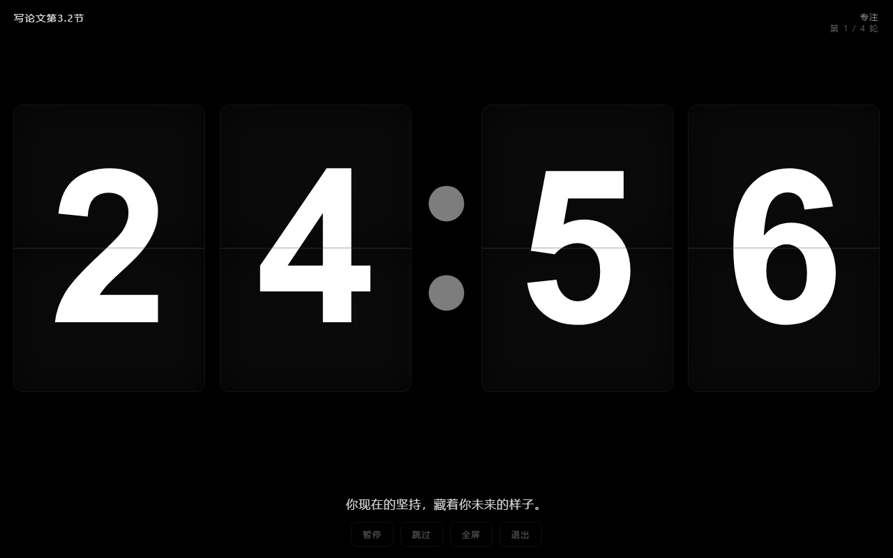
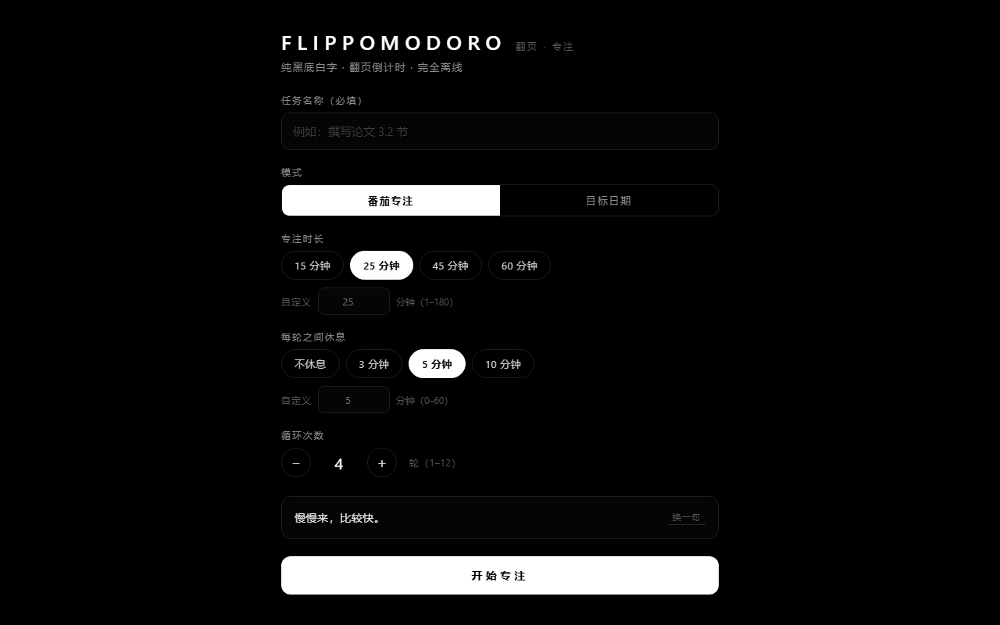

# flip-pomodoro · 翻页番茄钟

> **A fullscreen flip-clock Pomodoro timer in a single HTML file.** Pure black. White digits. Zero network. Double-click and it works.

[简体中文](README.zh-CN.md) · English

  



---

## Why another timer?

Most Pomodoro apps ask you to sign up, sync to a cloud you did not ask for, pay for a "pro" theme, or simply refuse to work when the Wi-Fi drops. This one is a **single 85 KB HTML file** with no build step, no dependencies at runtime, no accounts, and no requests — open it from a local disk and it runs forever, even in airplane mode.

The visual is a real split-flap clock, not a static number: every second the digit physically folds over.

## Features

| | |
|---|---|
| **Task name** | Required. Blocks start with an inline hint if empty. |
| **Focus length** | 15 / 25 / 45 / 60 min presets, or 1–180 min custom. |
| **Break length** | None / 3 / 5 / 10 min, or 0–60 min custom. Adjustable per session. |
| **Cycles** | 1–12 rounds, auto-transitions between focus and break. |
| **Encouraging quote** | A short line stays on screen during focus and rotates each round. |
| **Two modes** | Pomodoro, or countdown to a fixed goal date — switchable in settings. |
| **Goal mode** | Shows `days:hours:mins:secs` when more than 24 h away, `hours:mins:secs` after. |
| **Controls** | Pause / resume, skip stage, exit, fullscreen. `Space` pauses, `F` goes fullscreen. |
| **Screen stays awake** | Uses the Wake Lock API where available. |
| **Chime** | Synthesized with WebAudio — no audio files shipped. |
| **Remembers settings** | Task, durations, cycles and goal date persist in `localStorage`. |
| **Truly offline** | No CDN, no web fonts, no images, no analytics. |

## Quick start

**Windows / macOS / Linux** — download the repo, double-click `index.html`. Chrome or Edge recommended. Type a task, pick durations, hit **开始专注**.

**Phone, as a home-screen app**

- **iOS/iPadOS Safari** — open the page → Share → *Add to Home Screen*. Launching from the icon gives a standalone fullscreen window with no address bar. (Safari on iOS has no Fullscreen API, so this is the only way to get an immersive view.)
- **Android Chrome** — menu → *Add to Home screen*.

**Host it yourself** — it is one static file:

```bash
python -m http.server 8000
# then open http://localhost:8000/index.html
```

Any static host works (GitHub Pages, Netlify, an S3 bucket). There is nothing to configure.

## Two modes

| Pomodoro | Goal date |
|---|---|
| Focus N minutes → break M minutes → repeat for K rounds. | Count down to an absolute deadline (exam, submission, launch). |
| Pausable, skippable per stage. | Not pausable — a deadline does not pause. |
| Ends on a completion screen with rounds and total minutes. | Ends at zero. |



## URL parameters

Handy for kiosk mode — mount an old phone on the wall and boot straight into a running timer:

```
index.html?task=Writing&mins=25&break=5&rounds=4&autostart=1
index.html?mode=goal&goal=2026-12-31T23:59&task=Submission&autostart=1
```

| Param | Meaning |
|---|---|
| `task` | Task name |
| `mins` / `break` / `rounds` | Focus minutes / break minutes / rounds |
| `mode=goal` | Start in goal-date mode |
| `goal` | Target time, `YYYY-MM-DDTHH:MM` |
| `autostart=1` | Start immediately on load |

`autostart` bypasses a user gesture, so browsers will block fullscreen and audio — that is a browser security rule, not a bug. Clicking **开始专注** yourself is unaffected.

## Build from source

`index.html` is generated; edit the template instead.

```
flip-pomodoro/
├── index.html                  # generated — the whole app, one file
├── build/
│   ├── app.template.html       # readable source: markup, styles, logic
│   ├── build.py                # inlines vendor CSS/JS and the quote list
│   └── vendor/
│       ├── flipclock.min.js    # FlipClock.js 0.10.8 (MIT)
│       └── flipclock.css
├── docs/                       # screenshots + design notes
├── README.md / README.zh-CN.md
└── LICENSE
```

```bash
python build/build.py     # Python 3.9+, no third-party packages
```

The script substitutes three placeholders (`__FLIPCLOCK_CSS__`, `__FLIPCLOCK_JS__`, `__QUOTES__`) and rewrites `index.html`. To change the quotes, edit the `QUOTES` list in `build/build.py` and rebuild — do not hand-edit `index.html`.

## A note on the clock sizing

FlipClock 0.10.8 ships `.flip-clock { font-size: 1vw }` and re-renders its DOM on every tick, which silently overrides any `element.style.fontSize` you set from JavaScript — the clock looks right for one frame and then snaps back to a tiny size. This project avoids the fight entirely: it sets a CSS custom property `--emW` (total clock width in `em`, derived from the number of digit groups) on a container FlipClock never rebuilds, and lets CSS own the size:

```css
font-size: min(calc((100vw - 40px) / var(--emW, 21.86)), calc(52vh / 6)) !important;
```

Card geometry is `4em × 6em` with `0.333em` between cards and `1.5em` per group divider, so `--emW = groups × 8.333 + (groups − 1) × 1.5`. Two groups (min:sec), three (h:m:s) and four (d:h:m:s) all fit without overflow, on a 1280 px desktop and a 390 px phone alike.

## Credits

- Flip-clock animation: [FlipClock.js 0.10.8](https://github.com/objectivehtml/FlipClock) by Justin Kimbrell — MIT.
- Quotes: 56 short classical Chinese aphorisms, all public domain, bundled inline.
- Everything else: plain HTML, CSS and vanilla JavaScript. No framework, no bundler.

## License

[MIT](LICENSE) © flip-pomodoro contributors
