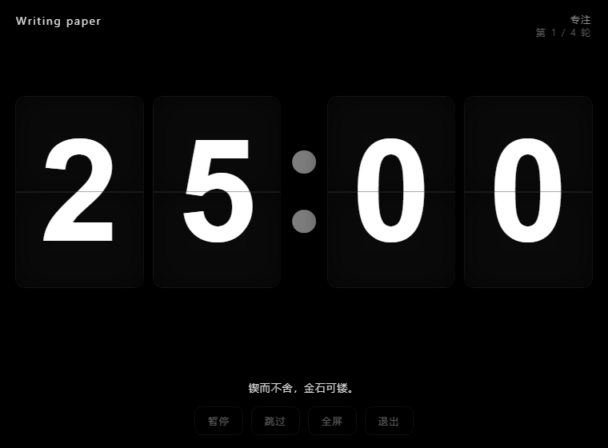
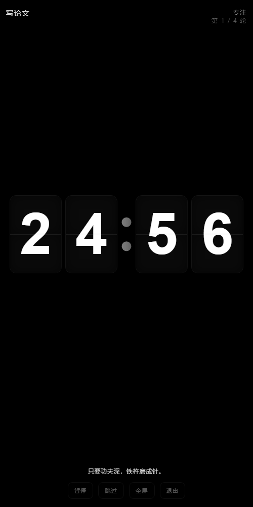
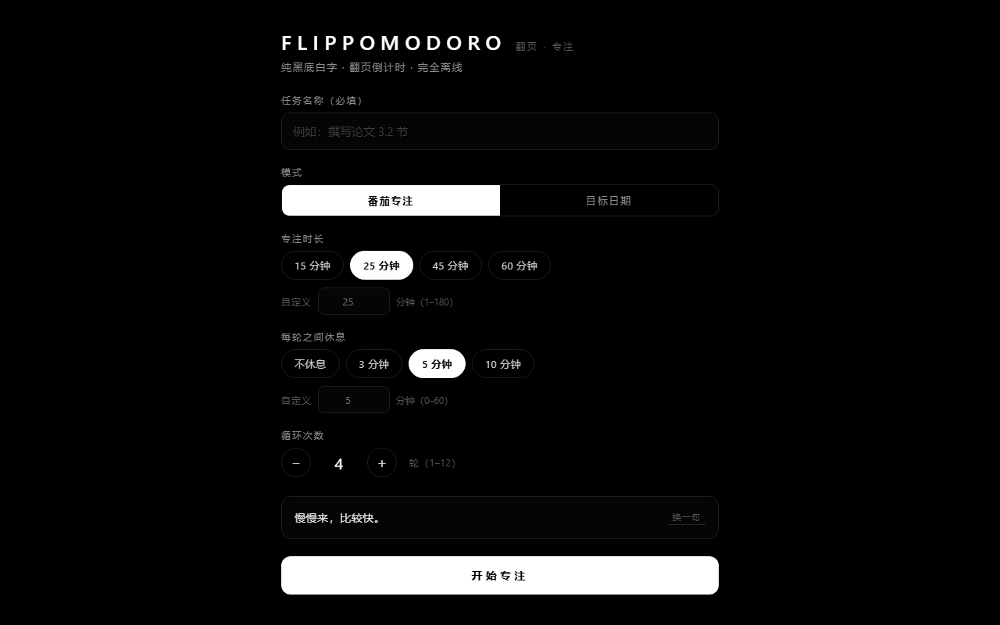

# flip-pomodoro · 翻页番茄钟

> **一个 HTML 文件的满屏翻页时钟番茄钟。** 纯黑底、纯白字、零联网，双击就能用。

简体中文 · [English](README.md)

  

**▶ [在线体验](https://flip-pomodoro.app.workbuddy.host/?sharecode=FSR4WGJCKG)**



---

## 为什么再造一个番茄钟

大部分番茄钟要你注册账号、同步到并不需要的云端、为“专业版主题”付费，或者干脆在断网时打不开。这个不一样：**整个应用就是一个 85 KB 的 HTML 文件**，没有构建步骤、运行时不依赖任何库、不联网、不要账号。放在本地磁盘上打开，飞行模式下也能一直跑。

画面是真的翻页钟，不是一张静止的数字图：每一秒数字都会翻转一次。

## 功能

| | |
|---|---|
| **任务名称** | 必填。为空时拦截开始并给出提示。 |
| **专注时长** | 15 / 25 / 45 / 60 分钟预设，或自定义 1–180 分钟。 |
| **休息时长** | 不休息 / 3 / 5 / 10 分钟，或自定义 0–60 分钟，每轮可调。 |
| **循环次数** | 1–12 轮，专注与休息之间自动切换。 |
| **励志句** | 专注期间常驻屏幕，每轮自动换一句，不重复。 |
| **两种模式** | 番茄专注 / 目标日期倒数，在设置页切换。 |
| **目标日期模式** | 距目标超过 24 小时显示「天:时:分:秒」，否则「时:分:秒」。 |
| **控制** | 暂停/继续、跳过当前阶段、退出、全屏。空格键暂停，`F` 全屏。 |
| **屏幕常亮** | 支持 Wake Lock 的浏览器会在专注期间保持屏幕不熄灭。 |
| **提示音** | 阶段结束播放真实玻璃钟声（Kenney，CC0，base64 内联），单轮与全部完成音效不同；WebAudio 兜底。 |
| **记住配置** | 任务名、时长、轮次、目标日期保存在 `localStorage`。 |
| **真正离线** | 无 CDN、无网络字体、无图片、无统计代码。 |

## 快速开始

**Windows / macOS / Linux** —— 下载后双击 `index.html`（推荐 Chrome / Edge）。填任务名 → 选时长 → 「开始专注」。

**手机，做成主屏应用**

- **iOS / iPadOS Safari** —— 打开页面 → 分享 → **添加到主屏幕**。从主屏图标启动即为独立全屏窗口，没有地址栏。（iOS 的 Safari 没有 Fullscreen API，这是获得沉浸式的唯一方式。）
- **Android Chrome** —— 菜单 → **添加到主屏幕**。



**自己托管** —— 它就是一个静态文件：

```bash
python -m http.server 8000
# 然后打开 http://localhost:8000/index.html
```

GitHub Pages、Netlify、对象存储都能直接放，不用任何配置。

## 两种模式

| 番茄专注 | 目标日期 |
|---|---|
| 专注 N 分钟 → 休息 M 分钟 → 循环 K 轮。 | 倒数到一个绝对截止时刻（考试、投稿、上线）。 |
| 可按阶段暂停、跳过。 | 不能暂停 —— 截止时间不会等你。 |
| 结束时显示完成页，统计轮次与总专注分钟。 | 归零即结束。 |



## URL 参数

适合 kiosk 场景 —— 把旧手机贴在墙上，开机直接进入运行中的倒计时：

```
index.html?task=写论文&mins=25&break=5&rounds=4&autostart=1
index.html?mode=goal&goal=2026-12-31T23:59&task=投稿截止&autostart=1
```

| 参数 | 说明 |
|---|---|
| `task` | 任务名称 |
| `mins` / `break` / `rounds` | 专注分钟 / 休息分钟 / 轮次 |
| `mode=goal` | 以目标日期模式启动 |
| `goal` | 目标时间，格式 `YYYY-MM-DDTHH:MM` |
| `autostart=1` | 载入后立刻开始 |

`autostart` 跳过了用户点击，浏览器会拦截全屏与音频 —— 这是浏览器的安全策略，不是 bug。手动点「开始专注」不受影响。

## 从源码构建

`index.html` 是生成物，改代码请改模板。

```
flip-pomodoro/
├── index.html                  # 生成物：完整应用，单文件
├── build/
│   ├── app.template.html       # 可读源码：结构、样式、逻辑
│   ├── build.py                # 把依赖、语录与提示音内联进 index.html
│   ├── make_gif.py             # 重新生成 docs/demo.gif（需要 Pillow）
│   ├── process_audio.py        # 裁尾 + 重采样玻璃钟声 WAV
│   └── vendor/
│       ├── flipclock.min.js    # FlipClock.js 0.10.8（MIT）
│       ├── flipclock.css
│       └── audio/              # 玻璃钟声源文件与处理后的 WAV
├── docs/                       # 截图与设计文档
├── README.md / README.zh-CN.md
└── LICENSE
```

```bash
python build/build.py     # 需要 Python 3.9+，无第三方依赖
```

脚本替换五个占位符（`__FLIPCLOCK_CSS__`、`__FLIPCLOCK_JS__`、`__QUOTES__`、`__CHIME_BREAK__`、`__CHIME_DONE__`）并重写 `index.html`。要换语录就改 `build/build.py` 里的 `QUOTES` 列表，要换提示音就替换 `build/vendor/audio/` 下的 WAV，再构建，不要手改 `index.html`。

## 关于倒计时字号的一个坑

FlipClock 0.10.8 自带 `.flip-clock { font-size: 1vw }`，而它每次走秒都会重建 DOM —— 于是你在 JavaScript 里设置的 `element.style.fontSize` 会在下一帧被悄悄覆盖，表现就是「点开始的瞬间是大字，然后立刻变小」。

本项目的做法是不去和它抢：把 CSS 变量 `--emW`（时钟总宽度，单位 `em`，由数字组数推导）设在一个 FlipClock 永远不会重建的容器上，字号完全交给 CSS 决定：

```css
font-size: min(calc((100vw - 40px) / var(--emW, 21.86)), calc(52vh / 6)) !important;
```

翻页卡片的几何是 `4em × 6em`，卡间 `0.333em`，组间分隔 `1.5em`，所以 `--emW = 组数 × 8.333 + (组数 − 1) × 1.5`。两组（分:秒）、三组（时:分:秒）、四组（天:时:分:秒）在 1280 px 桌面和 390 px 手机上都刚好铺满、不溢出。

## 致谢

- 翻页动画：[FlipClock.js 0.10.8](https://github.com/objectivehtml/FlipClock)，作者 Justin Kimbrell，MIT。
- 提示音：[Kenney Interface Sounds](https://kenney.nl/assets/interface-sounds)，CC0 1.0（公有领域），base64 内联。
- 语录：56 条短句中文格言，均为公有领域文本，已内联打包。
- 其余部分：原生 HTML / CSS / JavaScript，无框架、无打包器。

## 许可证

[MIT](LICENSE) © flip-pomodoro contributors
